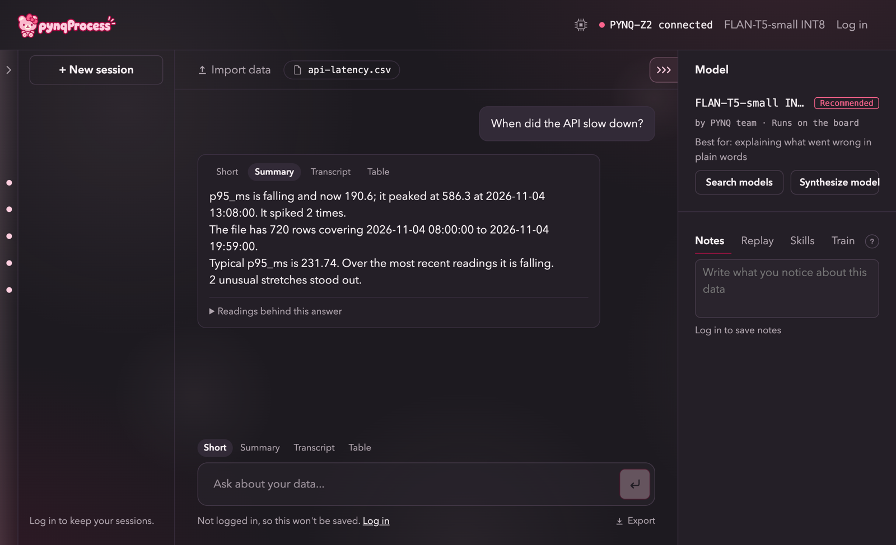

<p align="center">
  <a href="https://www.pynqprocess.site"></a>
</p>

<h3 align="center">ask your data anything ✨</h3>

<p align="center">
  <a href="https://www.pynqprocess.site"><b>🎀 Try it at pynqprocess.site 🎀</b></a>
</p>

<p align="center">
  Made at Hack Western 13 by Mohsen Sarrafan Chaharsoughi and Stefan Ilas
</p>

---

## 🐻 What it is

**PYNQ Process is a Mac app that lets you ask your data questions in plain words, and a $150 FPGA board answers them.**

Drop in a CSV, type *"What's wrong with my system?"*, and a small AI model running on a PYNQ-Z2 board reads your data and tells you what happened. Your data never leaves your desk.

<p align="center"></p>

## 🏆 Sponsors and tracks

| | How we use it |
| --- | --- |
| **Auth0** | Sign in with Google through Auth0 Universal Login (PKCE, nonce and audience checks). Signed-in users keep their sessions, notes and models. |
| **PCBWay · Best Hardware Prototype** | A real PYNQ-Z2 FPGA runs the model. The FPGA fabric does the INT8 matrix math and the ARM core drives generation. |
| **Overall** | The whole thing, Mac app to board. |
| **Best Beginner Hack** | Entered in the beginner category. |

## 💭 The problem

When a server, a sensor or a sales chart does something weird, you have two options today:

1. Dig through the numbers yourself, which takes time and know-how.
2. Paste them into a cloud AI, which costs money, needs the internet and sends your data to someone else.

We wanted a third option: **a tiny, cheap, private expert that sits next to your data.**

## 💡 Where the idea came from

We had been studying how much a small model really needs to know to be useful. The answer surprised us: a model squeezed into 8-bit integers is small enough for a cheap FPGA board and still gives good answers about one kind of data. So instead of renting a giant model in the cloud, we put a little one in a box you own.

## 🛠️ Our approach

```
Mac app  →  profiles your file  →  picks a model  →  PYNQ-Z2 board  →  answer in plain words
```

1. **Connect.** Press *Find boards*. The app finds the board over USB or Ethernet.
2. **Import.** Drop in a CSV or JSON lines file. The app reads the columns and spots signals like queues, latency, errors, temperature or sales.
3. **Pick a model.** The app recommends a small quantized model. You can search a library or build your own.
4. **Ask.** Type or dictate. A quantized FLAN-T5-small model answers on the board, and *Readings behind this answer* shows the exact data it used.

## 📦 What we cover

- **Data:** connection-pool queues (our first and deepest domain), API latency, server heat, disk IO, packet loss, sales and logs. 14 sample files ship with the app.
- **Answers:** Short, Summary, Transcript and Table views, plus follow-up questions.
- **Models:** three quantized FLAN-T5-small checkpoints ship today (Diagnosis, Queue history v2 and Telemetry v1). Switch, replay and compare them on the board, and edit them safely with a one-click restore.
- **Board twin:** the Mac can run the exact board service and the same INT8 checkpoints in software, so every flow can be rehearsed without hardware. Answers take about a second. See the [developer guide](docs/developer-guide.md#board-twin-on-the-mac).
- **Extras:** dictation, notes, history, export to Markdown, CSV or JSON, and an MCP connector so AI assistants can read your sessions.

## 📏 Honest numbers

- On the real board, the first words show up in about **9 to 10 seconds** and the full answer in about **14 to 18 seconds**, while the board keeps scoring live data.
- All 1,021 matrix projections per question run on the FPGA.
- Only queue files go to the board for model answers today. Other file types are answered with plain statistics on the Mac.

Every number links to a recorded run in [docs/results.md](docs/results.md).

## 🚀 Try it

1. Go to **[pynqprocess.site](https://www.pynqprocess.site)** and press *Get the app*.
2. Unzip it and open it. If macOS blocks it, open *System Settings → Privacy & Security* and press *Open Anyway*.
3. Press *Find boards*, or pick a sample file to look around.

## 📚 More

- [Developer guide](docs/developer-guide.md): build, run, test, repo map
- [Board setup](docs/board-setup.md): provision your own board
- [Measured results](docs/results.md): every timing and test
- [Engineering notes](docs/engineering.md) · [Research archive](research/) · [Paper research notebook](research/paper-notebook.md)

<p align="center"><br><sub>think with pynq</sub></p>
