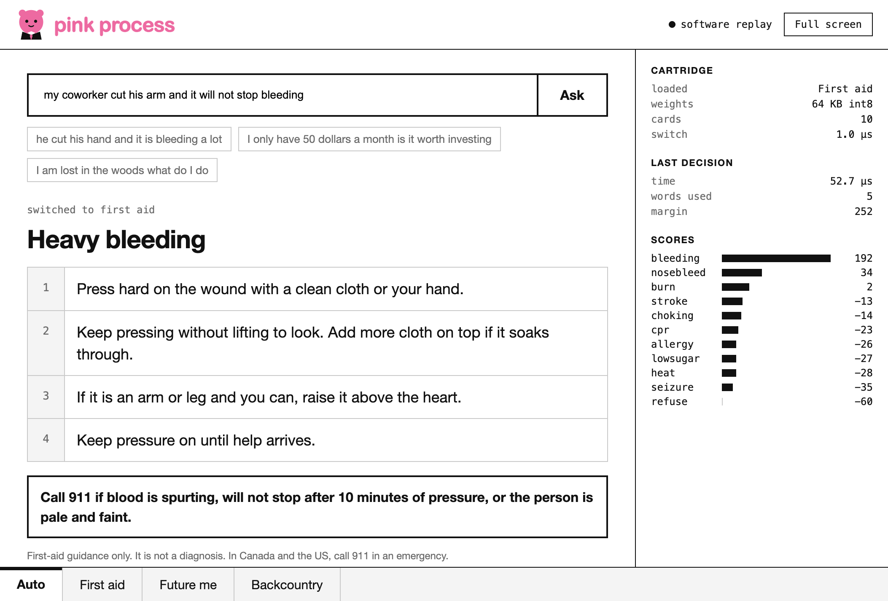

# pinkProcess

Plug in a $150 FPGA board and a person with no training gets the right steps for the job in front of them. Each field of expertise is a 64 KB cartridge of integer weights. Loading a different cartridge changes the expert; the circuit stays the same.

```sh
python3 -m cartridge.build     # train and quantise the cartridges
python3 -m cartridge.check     # held-out score and kernel test vectors
python3 -m cartridge.server    # http://127.0.0.1:5320
```



- [SPEC.md](SPEC.md): the full spec. Agents start here.
- [hw/README.md](hw/README.md): the FPGA kernel and how to check it.
- [research.md](research.md): the weight-reading research this builds on.
- [docs/hack-western.md](docs/hack-western.md): tracks and demo plan.

## Connection-pool forecaster

The first profile built in this repo is a
deterministic simulator and forecasting baseline for a service with a finite
database connection pool. Requires Python 3.10 or later and uses the standard
library. From the project root, run:

```sh
python3 -m pinkprocess
```

The demo fits a rule on eight 10-minute runs, then prints event-level metrics
and two concrete forecasts from four different 10-minute runs.

## Simulation and labels

- `simulator.py` models 12 connections with a FIFO queue. Arrivals have
  exponential gaps within each traffic regime. Ordinary traffic averages seven
  arrivals per second, and intermittent bursts average 11 to 21. Connection
  holds are sampled independently with a mean of about 850 ms. The simulator
  processes arrivals and releases in millisecond event time, with releases first
  on ties, then records busy and waiting counts every 100 ms. Each run's seed
  controls its traffic and service times.
- `dataset.py` emits an example at time `t` only when nobody is waiting and
  both windows fit within the run. The input contains 50 readings from
  `(t - 5 s, t]`. The label is positive when an arrival joined the queue in
  `(t, t + 10 s]`. Short queues can form and drain between samples, so labels
  come from the exact arrival log. Overlapping windows share data, so training
  and evaluation use disjoint sets of run seeds.

## Baseline and scoring

The score adds current utilization to the change in utilization per second
over the most recent two seconds multiplied by a positive weight in seconds.
The score can exceed 1 and has no probability interpretation.
The training grid chooses the weight and threshold that maximize
`2 × warned / (2 × warned + missed + false alerts)`, breaking ties in favor
of fewer false alerts.

A queue episode starts when an arriving request joins an empty queue and ends
when the queue drains. An alert starts on the first positive prediction in a
streak of consecutive 100 ms predictions. A negative prediction or a skipped
tick breaks the streak. Each alert start is matched to the first episode that
begins within its forecast. An episode gets one warning credit, and its lead
time runs from its earliest matched alert to its first queued arrival. Later
alert starts matched to that episode are reported as repeats. An alert start
with no episode in its forecast is false. A sustained positive streak starts
only one alert, even if a later prediction in the streak has a different
outcome.

The episode count includes starts after the first possible prediction time
(5 s) through run end. Near the end, later episodes have fewer eligible
prediction times because prediction stops 10 seconds before run end. False
alerts per hour use the total simulated duration of the held-out runs.

## Fit and save a logistic profile

```sh
python3 -m pinkprocess.train --output /tmp/pinkprocess-logistic.json
```

The [reference profile](profiles/pool-logistic-v1.json) stores the three
weights in feature order, the intercept, and the alert threshold. The
features are current utilization, its change per second over two seconds, and
the fraction of the last ten readings at full capacity. The prediction uses
`intercept + sum(weight * feature)` and alerts when that score reaches the
threshold. The sigmoid converts the score to a probability during training.
Inference can compare the raw score directly because the sigmoid is monotonic.

The trainer fits weights on seeds 100–105. On seeds 106–107, it sweeps score
thresholds and chooses the one that warns about the most episodes within the
baseline's validation false-alert count. Both models use the same event-level
scoring on seeds 200–203. The demo reloads the JSON and checks that every
held-out score and the decision threshold are reproduced exactly.

For inference without fitting, load the JSON with `Profile.load(Path(...))`.
Pass the result of `profile_features(example, capacity)` to
`profile.score(...)` and compare the returned score to `profile.threshold`.

## Try weight authoring on a second service

This workload changes the mean connection hold from 850 ms to 1,100 ms.
The capacity, arrival model, features, and label definition stay the same.
Fit runs use seeds 300–305, validation uses 306–307, and test uses 400–403.

```sh
python3 -m pinkprocess.author --output-dir /tmp/pinkprocess-service-b
```

Open `/tmp/pinkprocess-service-b/astra-training.txt` and give it to Astra.
It contains the instructions and a lossless grouping of the training
examples by feature vector and label. Each row's count is its frequency in
the training set. The conventional fit uses those same counts. Save the
returned JSON object with `weights` and `intercept` to
`/tmp/pinkprocess-astra-reply.json`, then run:

```sh
python3 -m pinkprocess.author --output-dir /tmp/pinkprocess-service-b \
  --astra /tmp/pinkprocess-astra-reply.json
```

The command calibrates both profiles against the same validation
false-alert budget, evaluates them on the same untouched test runs, and
saves the imported weights and locally chosen threshold in
`astra-profile.json`. It verifies the saved profile by reloading it and
comparing all held-out scores. Future scoring can use that JSON directly.

## Replay the Astra profile with fixed-point arithmetic

```sh
python3 -m pinkprocess.fixed_point --vectors /tmp/pinkprocess-fpga-vectors.json
```

The command loads the saved Astra profile and replays the four second-service
test runs. Features and weights use scale 256. Products, the intercept, and
the threshold use scale 65,536. Encoding rounds to nearest with ties to even,
including for negative utilization trends. After encoding, inference performs
three signed integer multiplications, adds the products to the integer
intercept, and compares the sum with the integer threshold using `>=`.

The [reference vectors](profiles/service-b-fixed-point-vectors.json) give
the integer inputs, expected sum, and expected alert bit. Replay vectors
include their run seed and timestamp. Two synthetic vectors exercise the
minimum and maximum sum over independently bounded inputs. Widen signed
products before adding them. The JSON lists the required signed widths for
the operands, products, sum, and comparison for this profile.
